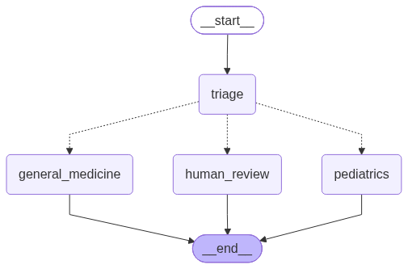

# Agentic Medical Scribe

A small, runnable tutorial showing how to build an agentic medical scribe with
[LangGraph](https://github.com/langchain-ai/langgraph). It takes the text
transcript of a clinical encounter, routes it to a specialty agent, and
generates a SOAP note using tools. You can get the context on using Jev instead of an LLM as a Judge in my article [here](https://medium.com/@gbenga-awodokun/building-clinical-ai-agents-with-langchain-and-jev-decision-healthcare-trustworthy-ai-lab-v2-1b81e271f1c9). Requires a Jev API and OpenAI to compare.


## What you will learn

1. **State** – one shared object that every step reads and writes.
2. **Nodes** – plain Python functions that do one job each (triage, write a note, escalate).
3. **Routing** – a conditional edge that picks the next node from the state.
4. **Tools** – functions the model can call (a dose calculator, a BMI calculator, a file writer).
5. **Decision vs generation** – the triage step can be run by an OpenAI LLM
   *or* by [Jev](https://docs.typesafe.ai), a decision model that returns
   typed answers with a confidence score. The rest of the graph is identical,
   so you can compare them directly, and a benchmark section does.

## The problem we are solving

A clinic records visits. Someone has to turn each recording into a structured
note. A single "summarize this" prompt works, but it has three weaknesses:

- It applies the same instructions to a toddler's ear infection and an adult's
  blood-pressure follow-up, even though those notes need different details.
- It cannot do arithmetic reliably (a 45 mg/kg dose for a 21 kg child).
- It will happily write a note for text that is not a clinical encounter at
  all, such as a call to reschedule an appointment.

The agentic version fixes each of these: a triage step picks a specialist,
each specialist has tools for the arithmetic, and a confidence gate sends
doubtful input to a human instead of guessing.

## How the graph runs

```
                 ┌─ triage_llm (OpenAI structured output) ─┐
transcript ──────┤                                         ├──> router ──┬──> pediatrics agent ──> tools ──> note
  (--triage)     └─ triage_jev (Jev: Choice+Noul+Score)   ─┘             ├──> general medicine agent ──> tools ──> note
                                                                         └──> human review (low confidence) ──> end
```

Here is a real run of the pediatric sample with Jev doing triage. Read it top
to bottom and you can see every building block fire:

```
$ python3 main.py transcripts/pediatrics_visit.txt --triage jev

Triage backend: jev
  [tool] calculate_pediatric_dose({'weight_kg': 21, 'mg_per_kg': 45}) -> 945 mg
  [tool] save_note({'patient_name': 'Emma', 'note': '**Subjective:** ...'}) -> Note saved to notes/emma_20261010_140642.md

Agent log:
[Triage/Jev] PEDIATRICS (confidence 1.00). specialty probabilities: pediatrics 1.00, general_medicine 0.00;
             needs_review 0.06; acuity 1.0 (Needs prompt follow-up within days)
[Pediatrics] Here is the final SOAP note for Emma: ...
```

And the same backend on a transcript that is just a receptionist moving an
appointment. Jev still guesses a specialty, but it also says the text is
probably not an encounter, so the router refuses to write a note:

```
$ python3 main.py transcripts/ambiguous_note.txt --triage jev

[Triage/Jev] GENERAL_MEDICINE (confidence 1.00). ... needs_review 0.96 ...
[Human review] Not auto-routed. specialty=general_medicine confidence=1.00 needs_review=0.96 ...

SENT TO HUMAN REVIEW (no note generated)
```

## Walkthrough of the code

### 1. State: `agents/state.py`

Everything the graph knows lives in one `TypedDict`. Each node receives the
whole state and returns only the keys it changed; LangGraph merges them.

```python
class ScribeState(TypedDict):
    messages: Annotated[list[BaseMessage], add_messages]   # log, append-only
    transcript: str            # input
    specialty: str             # set by triage
    triage_confidence: float   # 0..1, used by the router
    needs_review: float        # 0..1, "is this even a clinical encounter?"
    acuity: float              # 0 routine, 1 prompt follow-up, 2 urgent
    note: str                  # output
    ...
```

The `messages` field uses the `add_messages` reducer, so nodes append to the
log instead of overwriting it.

### 2. Triage, two ways

Both triage nodes read `state["transcript"]` and write the same keys. That is
what makes them swappable.

**Option A, an LLM as a judge** (`agents/triage.py`). We describe the
routing rules in a prompt and ask gpt-4o-mini to fill in a Pydantic model
with the same three answers Jev gives, plus a confidence it reports about
itself, plus a free-text reason and context summary.

```python
class TriageDecision(BaseModel):
    specialty: Literal["pediatrics", "general_medicine"]
    confidence: float            # self-reported, 0..1
    needs_review: bool
    acuity: Literal[0, 1, 2]
    reason: str
    context: str

decision = llm.with_structured_output(TriageDecision).invoke([...])
```

This works, but the confidence is whatever the model *says* it is. A
generative model has no mechanism that ties that number to how often it is
right. The benchmark below shows what that looks like in practice.

**Option B, a decision model** (`agents/triage_jev.py`). Jev does not
generate text. You give it text plus a set of typed questions, and it returns
a probability distribution for each. Three questions go in one request:

```python
TRIAGE_QUESTIONS = {
    "specialty": Choice(               # pick one label
        instructions="Which specialty agent should write the clinical note?",
        criteria={"pediatrics": "...under 18...", "general_medicine": "...adult..."},
    ),
    "needs_review": Noul(              # yes/no, returned as a probability
        instructions="The text is incomplete, ambiguous, or is not a clinical encounter",
    ),
    "acuity": Score(                   # ordered scale, returned as a weighted average
        instructions="How time-sensitive is the care discussed?",
        criteria=["Routine", "Needs prompt follow-up", "Urgent"],
    ),
}

response = get_jev().system_one(state=state["transcript"], questions=TRIAGE_QUESTIONS)
specialty = response.answers["specialty"]        # .choice, .confidence, .probabilities
needs_review = response.answers["needs_review"].noul
acuity = response.answers["acuity"].score
```

Now the router has numbers to work with.

| | OpenAI LLM | Jev |
|---|---|---|
| Returns | JSON it was asked to write | Typed answers with probabilities and a 0–1 confidence |
| Confidence | Self-reported in the JSON, not calibrated | A probability from the model, calibrated |
| Several questions | One prompt, one JSON blob | One request, any number of Choice / Noul / Score |
| Writes text | Yes (reason, summary) | No, decisions only |
| Role in this graph | Decide *and* explain | Decide. The specialist LLM still writes the note |
| Latency (measured) | about 1.2 s | about 0.13 s |
| Cost per triage (measured) | about $0.00020 | about $0.000045 |

The lesson: **use a decision model to decide and a generative model to write.**
TypeSafe documents this as
[confidence-gated routing](https://docs.typesafe.ai/patterns/confidence-routing)
and [intent routing](https://docs.typesafe.ai/patterns/intent-routing).

### 3. Router: `agents/router.py`

A conditional edge is just a function that returns the name of the next node.
Ours checks the decision signals before trusting the specialty:

```python
CONFIDENCE_THRESHOLD = 0.6
REVIEW_THRESHOLD = 0.5

def route_after_triage(state):
    if state["specialty"] == "human_review":            return "human_review"  # Jev call failed
    if state["needs_review"] > REVIEW_THRESHOLD:        return "human_review"
    if state["triage_confidence"] < CONFIDENCE_THRESHOLD: return "human_review"
    if state["specialty"] == "pediatrics":              return "pediatrics"
    return "general_medicine"
```

"The answer tells you what; confidence tells you whether to act."

### 4. Specialist agents and tools

`agents/pediatrics_agent.py` and `agents/generalmed_agent.py` are each a
prompt plus a list of tool names. They share one loop in
`agents/specialist.py`:

```python
llm_with_tools = llm.bind_tools(tools)
response = llm_with_tools.invoke(messages)

for _ in range(MAX_TOOL_ROUNDS):
    if not response.tool_calls:
        break                                   # model answered in plain text, done
    for call in response.tool_calls:
        result = tools_by_name[call["name"]].invoke(call["args"])
        messages.append(ToolMessage(content=str(result), tool_call_id=call["id"]))
    response = llm_with_tools.invoke(messages)  # give results back, ask again
```

That loop is the whole "agent": the model decides whether it needs a tool,
we run it, we hand back the result, and repeat until it is satisfied.

The tools in `tools/base.py` are ordinary functions decorated with `@tool`.
The docstring is what the model reads to decide when to call them:

```python
@tool
def calculate_pediatric_dose(weight_kg: float, mg_per_kg: float, max_mg: float | None = None) -> str:
    """Calculate a weight-based pediatric dose (mg) from weight in kg and mg per kg."""
```

- Pediatrics gets `calculate_pediatric_dose` and `save_note`.
- General Medicine gets `calculate_bmi` and `save_note`.

### 5. Human review: `agents/human_review.py`

A terminal node with no model call. It records why the transcript was not
auto-routed and leaves `note` empty. In production this would open a task
for a clinician.

### 6. Assembling the graph: `main.py`

```python
graph = StateGraph(ScribeState)
graph.add_node("triage", triage_node)          # triage_llm or triage_jev
graph.add_node("pediatrics", pediatrics_agent)
graph.add_node("general_medicine", generalmed_agent)
graph.add_node("human_review", human_review)

graph.add_edge(START, "triage")
graph.add_conditional_edges("triage", route_after_triage, {
    "pediatrics": "pediatrics",
    "general_medicine": "general_medicine",
    "human_review": "human_review",
})
graph.add_edge("pediatrics", END)
graph.add_edge("general_medicine", END)
graph.add_edge("human_review", END)
```

The triage node is always registered under the name `"triage"`, so swapping
the backend changes nothing else.



## Setup

Requires Python 3.11+.

```bash
pip install langgraph langchain-openai langchain-core python-dotenv pydantic typesafe-sdk

# Optional, for the visual Studio UI
pip install "langgraph-cli[inmem]"
```

Create a `.env` file in the project root (next to `main.py`):

```
OPENAI_API_KEY=sk-...        # note writer, used in both modes
TYPESAFE_API_KEY=ts-...      # only for --triage jev  (https://console.typesafe.ai/keys)

# Optional: record every run in LangSmith
LANGSMITH_API_KEY=lsv2_...
LANGSMITH_TRACING=true
LANGSMITH_PROJECT=scribe-health-ai-agent
```

## Run it

```bash
# OpenAI does the triage (default)
python3 main.py transcripts/pediatrics_visit.txt
python3 main.py transcripts/general_medicine_visit.txt --triage llm

# Jev does the triage
python3 main.py transcripts/pediatrics_visit.txt --triage jev
python3 main.py transcripts/general_medicine_visit.txt --triage jev

# Not a clinical encounter: Jev flags it, router sends it to human review
python3 main.py transcripts/ambiguous_note.txt --triage jev

# Your own transcript
python3 main.py path/to/transcript.txt --triage jev
```

`TRIAGE_BACKEND=jev` in the environment works instead of the flag. Tool calls
print as they happen, and each note is saved as Markdown under `notes/`.

## Watch it run

**LangGraph Studio.** `langgraph.json` registers both graphs as `scribe_llm`
and `scribe_jev`. From the project folder:

```bash
langgraph dev
```

Studio opens in your browser. Pick a graph in the dropdown, paste a transcript
into the `transcript` field, and run. Each node highlights as it executes and
the state is shown after every step, so you can watch `needs_review` arrive
from Jev and the router take the human-review branch.

**LangSmith.** With the optional variables set, every run is traced: the
triage call, the Jev request, each tool call, and the final model answer, as
nested spans under your project.

**Static diagram.**

```bash
python3 visualize.py --triage jev     # writes graph_jev.mmd and graph_jev.png
```

## LLM as a Judge vs Jev

Both backends answer the same three questions, so we can measure them head to
head. `benchmark_triage.py` runs **only the triage node** (no note writing)
on six transcripts, five times each per backend, and checks whether the
router would take the expected branch.

```bash
python3 benchmark_triage.py --runs 5     # writes benchmark_results.md / .json
```

The six transcripts, and the branch the router should take:

| Transcript | What it is | Expected branch |
|---|---|---|
| `pediatrics_visit.txt` | 6-year-old with an ear infection, mother present | pediatrics |
| `general_medicine_visit.txt` | Adult with headaches and high blood pressure | general_medicine |
| `sample_transcript/general_medicine.txt` | Long real-style adult visit, joint pain | general_medicine |
| `ambiguous_note.txt` | Receptionist moving an appointment. Not a visit | human_review |
| `teen_visit.txt` | 17-year-old alone with a sports knee injury. Borderline | pediatrics |
| `truncated_visit.txt` | Two lines, cut off mid-sentence | human_review |

### Results (gpt-4o-mini vs jev-latest, 5 runs each, 2026-10-11)

| Backend | Routing accuracy | Consistency | Median latency | p95 latency | Mean tokens (in+out) | Cost per triage | Cost per 1,000 triages |
|---|---|---|---|---|---|---|---|
| LLM as a judge | 87% | 97% | 1.17 s | 1.62 s | 1019+84 | $0.000203 | $0.203 |
| Jev | 87% | 97% | 0.13 s | 0.21 s | 1082+73 | $0.000045 | $0.045 |

Per transcript (mean over 5 runs):

| Transcript | Expected | Backend | Majority route | Accuracy | Confidence | needs_review | Acuity | Cost |
|---|---|---|---|---|---|---|---|---|
| pediatrics_visit | pediatrics | LLM | pediatrics | 100% | 1.00 | 0.00 | 1.0 | $0.000156 |
| | | Jev | pediatrics | 100% | 1.00 | 0.06 | 1.0 | $0.000030 |
| general_medicine_visit | general_medicine | LLM | general_medicine | 100% | 1.00 | 0.00 | 1.0 | $0.000153 |
| | | Jev | general_medicine | 100% | 1.00 | 0.05 | 0.1 | $0.000029 |
| general_medicine (long) | general_medicine | LLM | general_medicine | 100% | 1.00 | 0.00 | 1.0 | $0.000535 |
| | | Jev | general_medicine | 100% | 1.00 | 0.10 | 0.2 | $0.000139 |
| ambiguous_note | human_review | LLM | human_review | 100% | 1.00 | 1.00 | 0.0 | $0.000117 |
| | | Jev | human_review | 100% | 1.00 | 0.96 | 0.0 | $0.000024 |
| teen_visit | pediatrics | LLM | pediatrics | 100% | 0.90 | 0.00 | 0.0 | $0.000152 |
| | | Jev | **human_review** | 20% | **0.54** | 0.06 | 0.1 | $0.000030 |
| truncated_visit | human_review | LLM | **general_medicine** | 20% | 0.90 | 0.20 | 0.6 | $0.000105 |
| | | Jev | human_review | 100% | 1.00 | 0.92 | 0.2 | $0.000020 |

### What the numbers say

- **On clear-cut transcripts both are perfect.** The four straightforward
  cases route correctly every time with either backend.
- **Jev is about 9x faster.** Median 0.13 s against 1.17 s. It is not
  generating tokens, just scoring the questions, and all three questions go
  in one request.
- **The LLM's confidence is not information.** It reported 1.00 on the easy
  cases and exactly 0.90 on both hard cases, including the one it got wrong.
  The number never moved with the actual difficulty, so the router cannot
  use it. Jev's confidence fell to around 0.5 on the borderline teenager and
  its `needs_review` jumped from under 0.10 to 0.92 on the fragment.
- **The LLM wrote up a two-line fragment as a visit.** On `truncated_visit`
  it chose general medicine at 0.90 confidence in four of five runs and
  would have handed the specialist a transcript with no complaint in it.
  Jev flagged it for review five times out of five.
- **Jev's "miss" is an abstention.** The 17-year-old seen without a parent,
  with an adult-style sports injury, sits right on the
  pediatrics / general-medicine boundary. Jev's probabilities split roughly
  50/50, hovering around the 0.6 threshold, and the router sent it to a
  human in four runs of five. The LLM picked pediatrics and was scored
  correct, but it gave that answer with the same 0.90 it gave the fragment.
  Which behaviour you want depends on the cost of a wrong note versus the
  cost of a human look. In a clinical setting, abstaining on a coin flip is
  usually the right call.

### Cost

List prices on 2026-10-11: gpt-4o-mini is $0.15 per million input tokens
and $0.60 per million output tokens. Jev is $0.042 per million input tokens
and output tokens are free.

| | LLM as a judge | Jev |
|---|---|---|
| Tokens per triage (mean) | 1019 in + 84 out | 1082 in + 73 out |
| Cost per triage | $0.000203 | $0.000045 |
| Cost per 1,000 triages | $0.20 | $0.045 |
| Cost per 1,000,000 triages | $203 | $45 |

Both backends read roughly the same number of input tokens, because the
transcript dominates and Jev's question text is about as long as the LLM's
prompt. The gap comes from the per-token price and from Jev's output being
free. Jev works out about **4.5x cheaper per decision**.

To put triage in context, a whole run (triage plus the specialist writing
the note with tool calls) measured on the two short samples:

| | LLM triage | Jev triage |
|---|---|---|
| OpenAI tokens for the whole run | about 2,050 in + 580 out | about 1,390 in + 500 out |
| OpenAI cost | about $0.00066 | about $0.00051 |
| Jev cost | – | about $0.00003 |
| **Total per run** | **about $0.00066** | **about $0.00054** |

Writing the note is most of the bill either way. Moving the decision to Jev
removes the triage prompt from OpenAI's meter and trims a full run by
roughly a fifth. At a million visits a year that is around $120 saved on
triage alone, which is modest. The larger savings come from what the
confidence enables: not paying for a note on input that should never have
reached the specialist, and not paying a human to fix a note written from
a fragment.

Your numbers will differ a little run to run. Re-run the script and compare
against `benchmark_results.md`.

## Project layout

```
main.py                     Builds the graph, picks the triage backend, runs one transcript
langgraph.json              Registers both graphs for LangGraph Studio
visualize.py                Exports the graph as Mermaid / PNG
benchmark_triage.py         LLM-as-a-judge vs Jev triage benchmark
benchmark_results.md        Latest benchmark output (also .json)
pyproject.toml              Package metadata
LICENSE                     MIT license
agents/
  state.py                  ScribeState shared across nodes
  llm.py                    ChatOpenAI model (gpt-4o-mini)
  jev.py                    TypeSafe client (Jev), created lazily
  triage.py                 Triage backend 1: OpenAI structured output
  triage_jev.py             Triage backend 2: Jev Choice + Noul + Score
  router.py                 Conditional edge with confidence gate
  human_review.py           Terminal node for low-confidence transcripts
  specialist.py             Shared tool-calling loop
  pediatrics_agent.py       Pediatric SOAP note writer
  generalmed_agent.py       General medicine SOAP note writer
tools/
  base.py                   calculate_bmi, calculate_pediatric_dose, save_note
transcripts/                Sample inputs: pediatric, adult, teen, non-clinical, truncated
notes/                      Generated notes land here
```

## Exercises

1. **Move the bar.** Set `CONFIDENCE_THRESHOLD` to 0.45 in `agents/router.py`
   and re-run the benchmark. Jev now routes the teenager to pediatrics. Then
   set it to 0.95 and see what happens to the LLM backend's 0.90 answers.
2. **Add a question.** Add a `Noul` to `TRIAGE_QUESTIONS` asking whether a
   medication was prescribed, and surface it in the specialist prompt. It
   costs no extra API call.
3. **Add a specialty.** Create `agents/cardiology_agent.py` using
   `generate_note`, add `cardiology` to the `TriageDecision` literal and the
   Jev `Choice` criteria, and wire it in `main.py`.
4. **Add a tool.** Write a `lookup_icd10(condition)` tool in `tools/base.py`
   and give it to both specialists.
5. **Compare backends.** Run `sample_transcript/general_medicine.txt` with
   `--triage llm` and `--triage jev`. Compare the triage lines, then open the
   LangSmith traces and compare latency.

## Disclaimer

This project is a teaching example for building agentic workflows. It is
**not a medical device and not clinical software.**

- Generated notes may contain errors, omissions, or hallucinated details.
- The dose and BMI tools are simple arithmetic with no safety checks, drug
  interaction data, or age-specific limits.
- Triage decisions, including the confidence gate, are illustrative and have
  not been validated on real clinical data.
- Nothing here constitutes medical advice. Do not use it to make or support
  decisions about patient care.
- Sample transcripts are fictional. If you run real transcripts, you are
  responsible for patient privacy and for complying with regulations such as
  HIPAA or GDPR, including what you send to third-party APIs (OpenAI,
  TypeSafe, LangSmith).

## License

Released under the [MIT License](LICENSE). You are free to use, copy, modify,
and redistribute this code, including commercially, provided the copyright
and license notice are kept. The software is provided "as is" without
warranty of any kind; see the LICENSE file for the full text.
