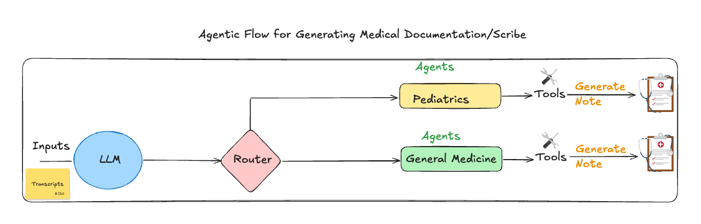

# Agentic Medical Scribe

A small, runnable tutorial showing how to build an agentic medical scribe with
[LangGraph](https://github.com/langchain-ai/langgraph). It takes the text
transcript of a clinical encounter, routes it to a specialty agent, and
generates a SOAP note using tools.



## How it works

```
transcript ──> triage (LLM) ──> router ──┬──> pediatrics agent ──> tools ──> note
                                         └──> general medicine agent ──> tools ──> note
```

1. **Triage** – an LLM reads the transcript and decides, with structured
   output, whether the encounter is `pediatrics` or `general_medicine`. It also
   writes a short context summary for the specialist.
2. **Router** – a conditional edge sends the state to the matching agent.
3. **Specialist agent** – writes a SOAP note (Subjective, Objective,
   Assessment, Plan). Each agent has its own prompt and tool set:
   - Pediatrics: `calculate_pediatric_dose`, `save_note`
   - General Medicine: `calculate_bmi`, `save_note`
4. **Tools** – the agent calls tools in a loop until it is ready to answer.
   `save_note` writes the finished note to the `notes/` folder.

## Project layout

```
main.py                     Builds the graph and runs one transcript
agents/
  state.py                  ScribeState shared across nodes
  llm.py                    ChatOpenAI model (gpt-4o-mini)
  triage.py                 Triage node: picks the specialty
  router.py                 Conditional edge after triage
  specialist.py             Shared tool-calling loop used by both agents
  pediatrics_agent.py       Pediatric SOAP note writer
  generalmed_agent.py       General medicine SOAP note writer
tools/
  base.py                   calculate_bmi, calculate_pediatric_dose, save_note
  __init__.py               Exports the tools
transcripts/                Sample input transcripts
notes/                      Generated notes are saved here
```

## Setup

Requires Python 3.11+.

```bash
pip install langgraph langchain-openai langchain-core python-dotenv pydantic
```

Set your OpenAI API key, either in the environment or in a `.env` file:

```bash
export OPENAI_API_KEY=sk-...
```

## Run

```bash
# Pediatric sample (ear infection, weight-based antibiotic)
python3 main.py transcripts/pediatrics_visit.txt

# Adult sample (headaches, elevated blood pressure)
python3 main.py transcripts/general_medicine_visit.txt

# No argument defaults to the general medicine sample
python3 main.py
```

Tool calls are printed as they happen, the note is saved under `notes/`, and
the final note is printed at the end.

## Try your own transcript

Save any doctor–patient conversation as a plain text file and pass its path to
`main.py`. Triage will pick the specialty automatically.

## Extending the tutorial

- Add a new specialty: create `agents/<name>_agent.py` that calls
  `generate_note`, add the option to `TriageDecision` in `agents/triage.py`,
  and wire the node in `main.py`.
- Add a tool: define it with `@tool` in `tools/base.py`, register it in
  `ALL_TOOLS`, and list its name in the agent's `tool_names`.
- Swap the model: edit `agents/llm.py`.

## Disclaimer

This is a teaching example only. Generated notes and dose calculations are not
validated for clinical use.
